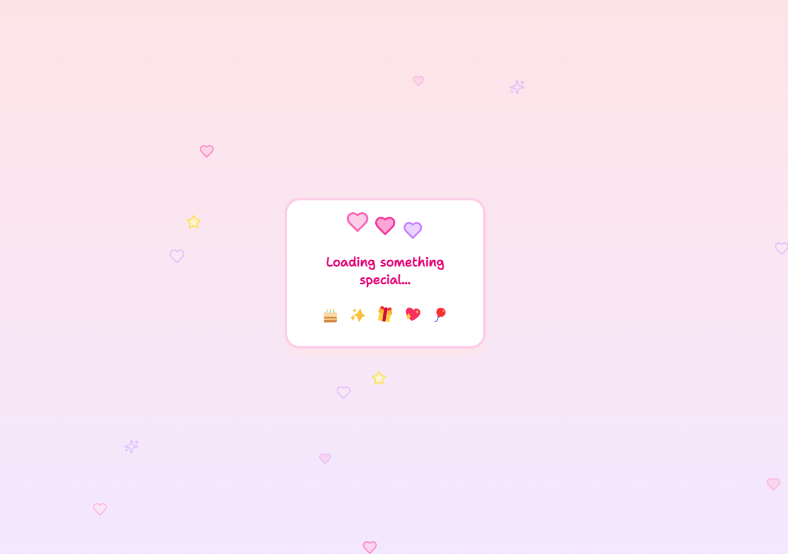
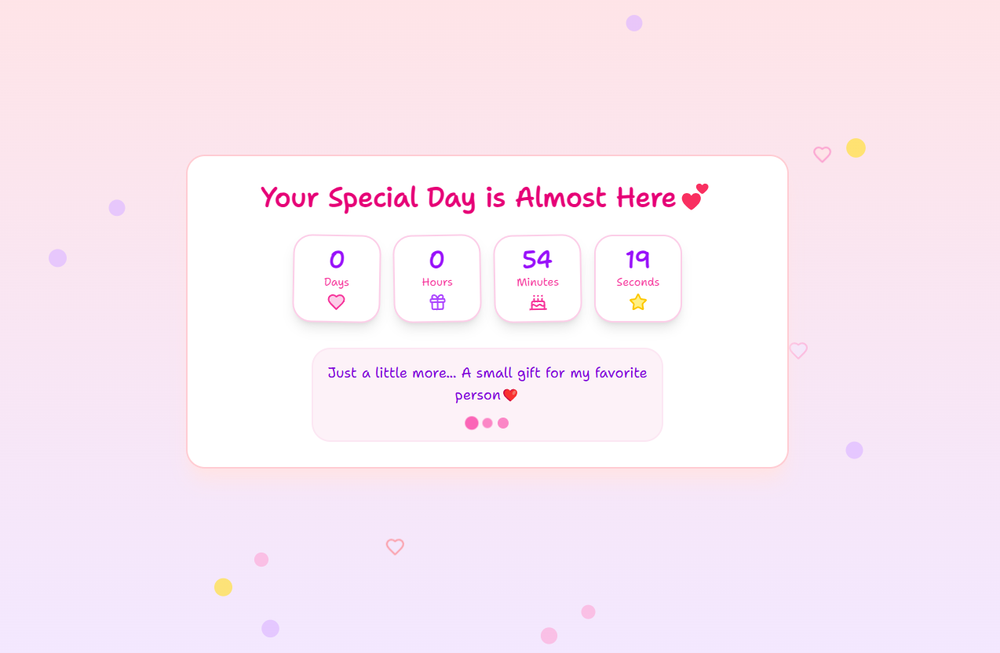
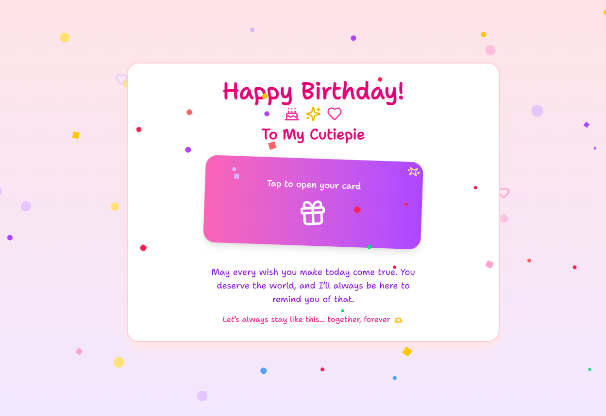

# Birthday Surprise Website

A personalized birthday experience built with Next.js. It starts with a short animated loader, counts down to midnight, and then opens an interactive celebration card with a private photo memory deck.

## Preview

### Loader



### Countdown



### Celebration Card



## Features

- Live countdown with days, hours, minutes, and seconds.
- Countdown target set to the next local midnight by default.
- Animated loader, floating hearts, bubbles, and confetti.
- Personalized birthday heading and messages.
- Interactive card opened with the **Tap to open your card** button.
- 13-photo memory deck with tap-to-next, Previous, Next, and Close controls.
- Optional looping birthday music from `public/birthday.mp3`.
- Responsive layout for desktop and mobile screens.

## Tech Stack

- [Next.js 15](https://nextjs.org/)
- [React 19](https://react.dev/)
- [Tailwind CSS 4](https://tailwindcss.com/)
- [Framer Motion](https://www.framer.com/motion/)
- [Lucide React](https://lucide.dev/)

## Getting Started

### Prerequisites

- Node.js 18.18 or newer
- npm

### Installation

Clone the repository, install dependencies, and start the development server:

```bash
git clone https://github.com/YOUR_USERNAME/YOUR_REPOSITORY.git
cd birthday-site-main
npm ci
npm run dev
```

Open [http://localhost:3000](http://localhost:3000) in your browser.

Replace `YOUR_USERNAME/YOUR_REPOSITORY` with the GitHub repository URL after creating the repository.

## Production

Run the checks and create an optimized production build:

```bash
npm run lint
npm run build
npm run start
```

## Deploy on Vercel

1. Push this project to GitHub.
2. Open [vercel.com](https://vercel.com) and sign in with GitHub.
3. Select **Add New Project** and import this repository.
4. Keep the default Next.js settings.
5. Select **Deploy**.

Vercel will provide a public URL that can be shared with anyone. Photos in `public/images` and the music file in `public/birthday.mp3` are included in the deployment.

## Personalization

### Countdown

The default countdown targets the next local midnight using the visitor's device timezone. To use a fixed date and time, replace the `birthdayDate` state initializer in `src/app/page.jsx`:

```js
const [birthdayDate] = useState(() => new Date("2027-04-28T00:00:00+05:30"))
```

The time offset in the example is India Standard Time. Change it to the timezone required for the celebration.

### Text

Edit the heading, recipient name, and celebration messages in `src/components/birthday-celebration.jsx`.

### Photos

Place photos in `public/images` and update the `photos` array in `src/components/birthday-celebration.jsx`. Each path must begin with `/images/`.

### Music

Replace `public/birthday.mp3` with another MP3, or update the audio source in `src/app/page.jsx`. Browsers may block audio until the visitor interacts with the page.

## Project Structure

```text
src/app/page.jsx                         Main countdown and celebration flow
src/components/countdown.jsx             Countdown display
src/components/birthday-celebration.jsx Celebration text and photo deck
src/components/Loader.jsx                Initial loading screen
src/components/confetti.jsx              Celebration confetti
src/components/floating-hearts.jsx      Background hearts
public/images/                            Birthday photo assets
public/birthday.mp3                       Background music
```

## License

This project is intended for personal use. Add a license file before redistributing it publicly.
